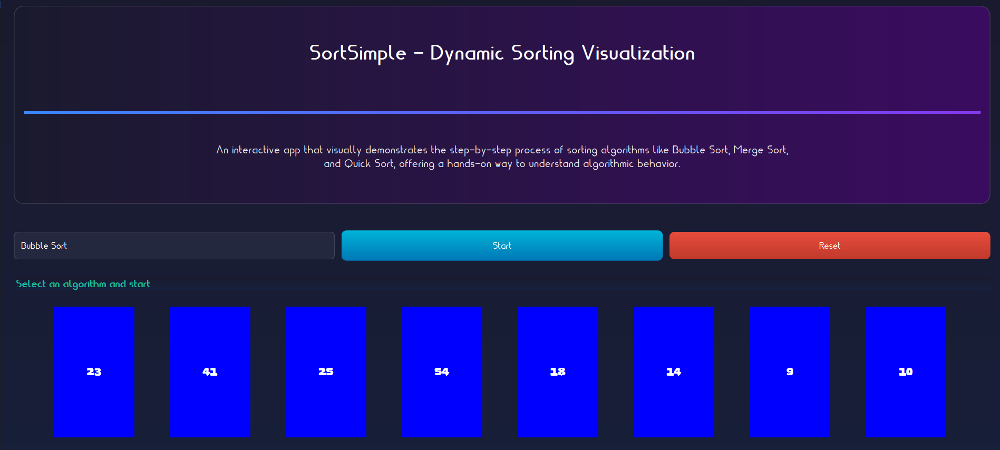
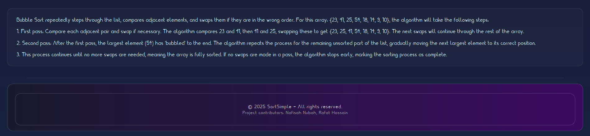

# Sort Simple: Dynamic Sorting Visualization and Interactive App

## Overview

**Sort Simple** is a Qt desktop app that animates sorting algorithms one step at a time. It demonstrates Bubble Sort, Merge Sort, Quick Sort, Insertion Sort, and Selection Sort on a small demo array so you can see each comparison and swap as it happens.

## Features

* **Sorting Algorithm Visualizations**: Animates Bubble Sort, Merge Sort, Quick Sort, Insertion Sort, and Selection Sort.
* **Demo Bars**: Bars represent a fixed eight-element array (`23, 41, 25, 54, 18, 14, 9, 10`). The data is a deterministic demo and does not shuffle. Reset restores that same starting order.
* **Step-by-Step Process**: Each algorithm runs as a state machine that advances one move per timer tick, so the animation shows every comparison and swap.
* **Start and Reset Buttons**: Start begins the animation. Reset restores the original order and stops the timer.

## Supported Sorting Algorithms

* Bubble Sort
* Insertion Sort
* Merge Sort
* Quick Sort
* Selection Sort

## Getting Started

### Run (Windows)

The Windows build, including the Qt runtime, is published as a GitHub Release asset rather than stored in this repository. Download the `Desktop-Release` folder from the Releases page and run `SortSimple.exe` from inside it. The DLLs and fonts sit next to the executable, so nothing else needs installing.

### Build from Source

Requires Qt 5 or Qt 6 with the Widgets module, CMake 3.16 or later, and a C++17 compiler.

```bash
cmake -S SortSimple -B build
cmake --build build
```

Then run the SortSimple binary from the build directory. The app loads `Nasa21-l23X.ttf` and `SuperComic-qZg62.ttf` from the directory that holds the executable. Copy those two files from `SortSimple/` next to the built binary if the default fonts are missing.

Tests for the sort steppers live in `tests/`. After building:

```bash
ctest --test-dir build --output-on-failure
```

## Usage

1. Launch the application.
2. Select a sorting algorithm from the dropdown.
3. Click "Start" to watch the bars rearrange step by step.
4. Press "Reset" to restore the original order and try another algorithm.

## Screenshots





## Contributors

* Nafisah Nubah (@nafisahnubah): UI styling, header and footer layout, button styling, insertion sort
* Rafat Hossain (@RafatH0ssain): sorting algorithms, animation logic, reset flow, algorithm descriptions, fonts

## License

MIT. See [LICENSE](LICENSE) and [THIRD_PARTY_NOTICES](THIRD_PARTY_NOTICES) for Qt and font terms.
